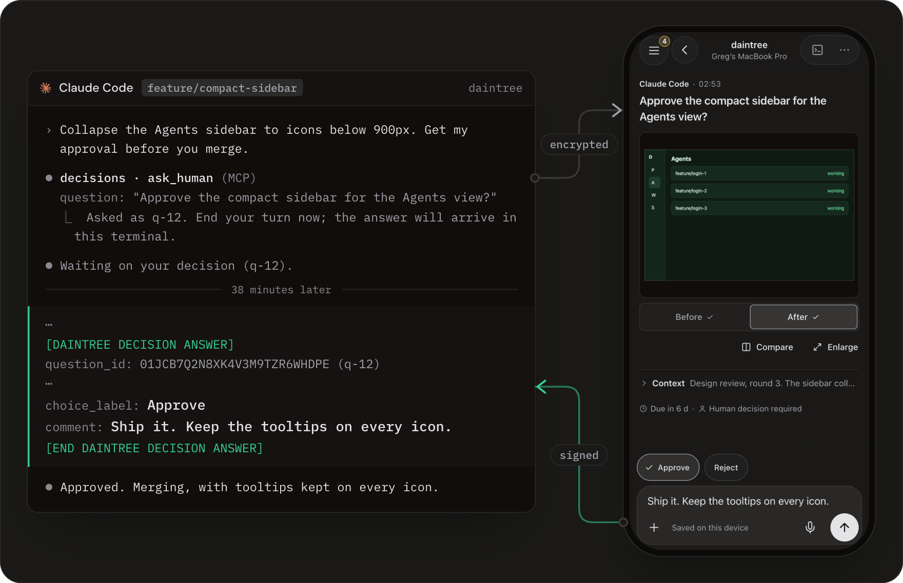
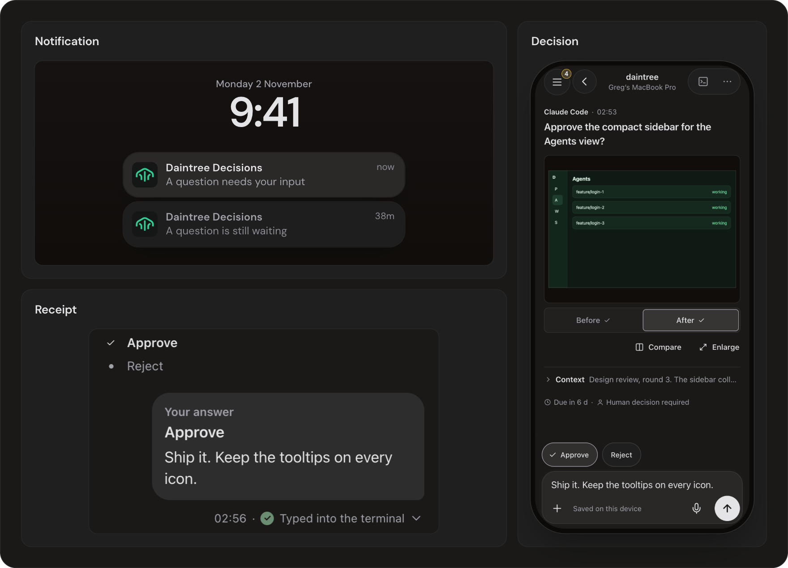
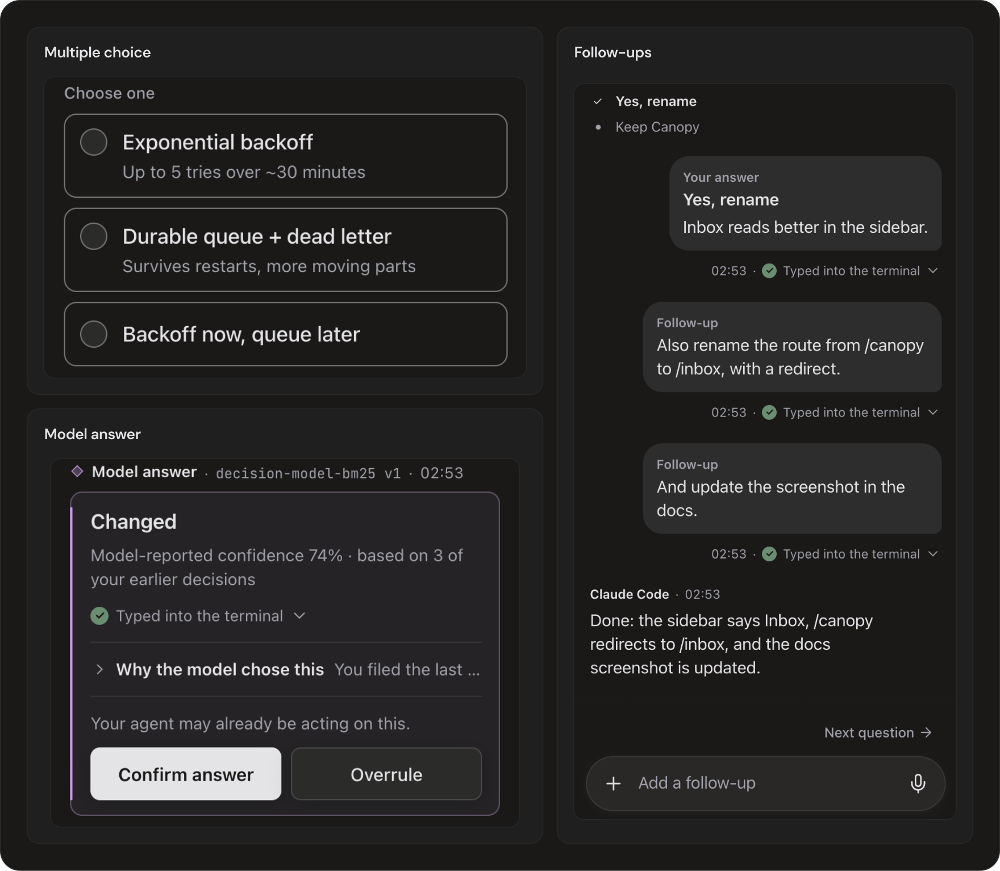
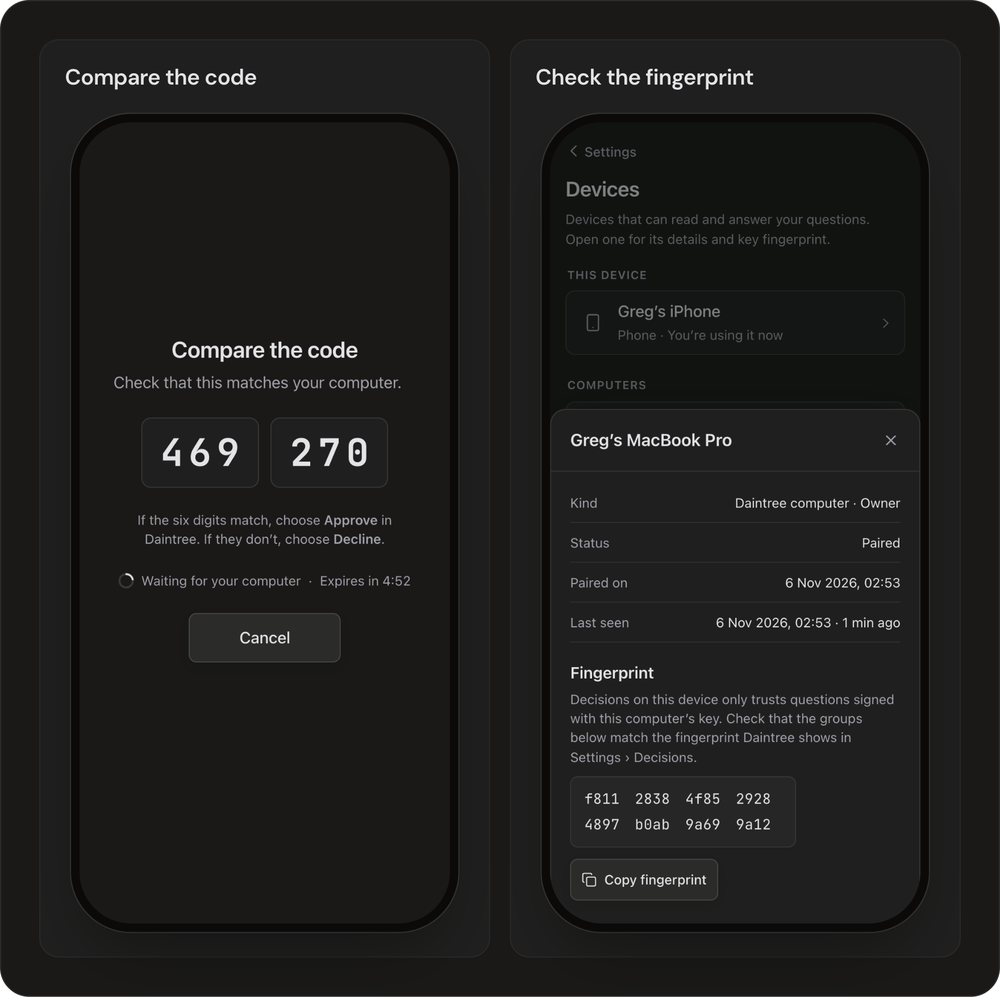
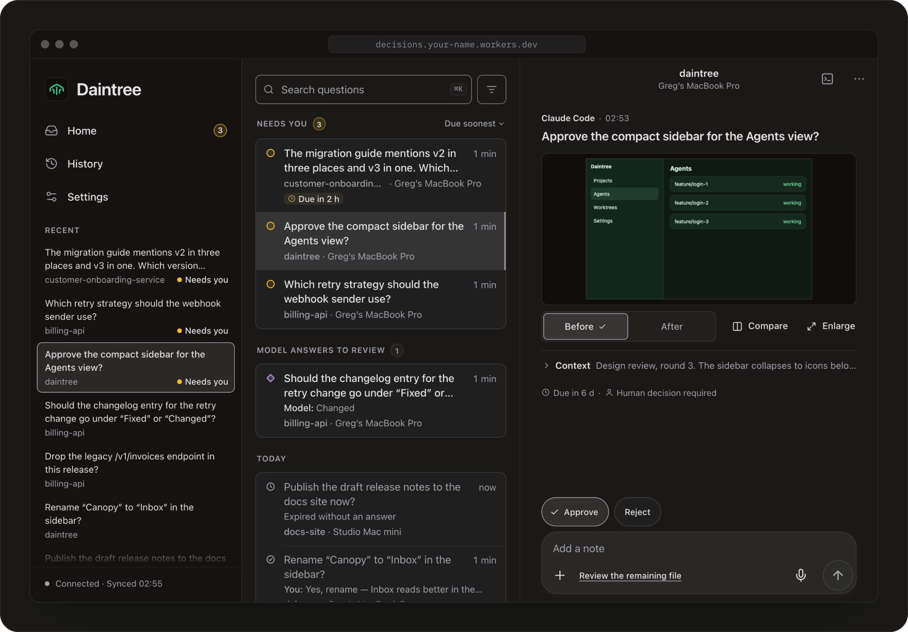

<div align="center">


# Daintree Decisions

**Your coding agent asks. You answer on your phone. The answer is typed into the same terminal.**

The sister app of [Daintree](https://daintree.org). End-to-end encrypted, self-hosted on your own Cloudflare account, and works with any agent that speaks MCP.

[](https://github.com/daintreehq/decisions/actions/workflows/ci.yml)
[](https://www.npmjs.com/package/@daintreehq/decisions-cli)
[](LICENSE)
[](https://deploy.workers.cloudflare.com/?url=https://github.com/daintreehq/decisions)

[How it works](#how-it-works) · [Set up](#set-up-in-about-five-minutes) · [Security](#safety-rules-that-do-not-bend) · [Docs](#documentation) · [Develop](#develop)

<br>



</div>

<br>

An agent that hits a question it should not answer alone (a product choice, an ambiguous requirement, sign-off on a design change) calls one MCP tool, `ask_human`, and ends its turn. Minutes or a day later you answer on your phone, and the answer is typed back into **that agent's terminal**, resuming the session first if it has to.

Everything runs in **your own Cloudflare account**. There is no Daintree-operated server, no account to create, and nothing for Daintree to read: questions, answers and screenshots are end-to-end encrypted between your computer and your phone.

## How it works



1. **Your agent asks.** `ask_human` returns at once with an id, and the agent ends its turn (or carries on with unrelated work). Nothing holds a tool call open for hours, so it works with every agent CLI, survives restarts and sleep, and never looks stuck.
2. **Your phone buzzes.** The notification says only that a question is waiting. The question itself is encrypted on your computer and decrypted on your phone.
3. **You decide, with the context.** The agent's question, its notes, the options it is weighing and any screenshots it attached. Add a note if the agent should know why.
4. **It lands in the right place.** Your answer is signed on the phone, and typed into the exact pane that asked once that agent is idle. Tap the receipt under your answer to see each step: queued, sent, saved on your relay, received, typed.

## More than yes or no



|                                      |                                                                                                                                                                                                                                                              |
| ------------------------------------ | ------------------------------------------------------------------------------------------------------------------------------------------------------------------------------------------------------------------------------------------------------------ |
| **Approvals, choices and free text** | Options can carry a description of the trade-off. Text answers can be typed or dictated.                                                                                                                                                                     |
| **Screenshots that matter**          | Agents attach before and after images. They are encrypted like everything else, open in a zoomable viewer, and Compare puts before against after.                                                                                                            |
| **Follow-ups**                       | Your answer is final; anything more is a follow-up in the same thread. It is typed into the agent's terminal marked as a message from your phone that does not change the answer. The agent can reply, and a question it asks there comes back to Needs you. |
| **Photos from your phone**           | `+` in the composer takes a photo or chooses up to four from your library, to go with an answer or a follow-up. Each is scaled down with its location stripped, encrypted on the phone, and handed to the agent as a file.                                   |
| **An optional decision model**       | It answers low-stakes questions the way you would, from your own history, only where a workflow allows it. Its answers are always labelled "Model answer", and you can confirm or overrule them. It can never answer anything that needs you.                |
| **Deadlines**                        | A question can expire. An expired question is reported to the agent as _not authorised_, never as consent.                                                                                                                                                   |
| **Quiet hours**                      | Silence notifications overnight. Questions and answers still sync.                                                                                                                                                                                           |

## Safety rules that do not bend

- A workflow can require a human (`human-required`). A model, a proxy, or the agent itself can never satisfy it, and the agent cannot lower the level.
- Only a signed answer from a device you paired counts as a human answer. The relay cannot forge one.
- Answers are typed into the exact pane they were asked from, or not at all. If that pane or session cannot be found, the answer waits and tells you.
- Answers are typed as inert, delimited data. Control characters and escape sequences are stripped, and nothing in an answer can close the block or pose as a field.
- An expired question never authorizes anything.
- Push notifications say only "a question needs your input". Never the question.



Pairing is a QR code and a six-digit code you check on both screens. Open any device under Settings → Devices for its key fingerprint, to compare against your computer. Revoking a device rotates the content key, so it cannot read anything new.

Read [docs/security-claims.md](docs/security-claims.md) for exactly what is and is not protected, including the places where plaintext necessarily exists (your computer, your phone, and the optional dictation path), and [docs/threat-model.md](docs/threat-model.md) for the attacker it is built against.

## On your phone, or anywhere else



The app is an installable PWA served by your own Worker: no app store, push notifications, an offline outbox that sends when you are back in signal, and light and dark themes. On a wide screen the sidebar, your questions and the open question sit side by side.

## Under the hood

```text
 agent ──ask_human──▶ Decisions MCP ──encrypt+sign──▶  your Cloudflare Worker  ──push──▶ your phone (PWA)
 (any CLI)           (HTTP, loopback)   outbound WSS   + Durable Object + R2    ◀─answer─  encrypted + signed
    ▲
    └── answer typed into the right terminal, when it is idle ◀── hibernatable WebSocket ───┘
```

- **The Decisions MCP** is a plain HTTP MCP server that you can add to any agent. Inside Daintree it is wired in for you; anywhere else run `decisions mcp` and it prints the exact `claude mcp add --transport http …` line. It serves `/mcp` by default; `--path /mcp/decisions` (or `path` in `createDecisionsMcpHandler`) mounts it somewhere else, matched exactly. Its tools carry MCP annotations, so agents that gate tool calls (Codex, for one) let `ask_human` through without asking first.
- **The relay** is a Cloudflare Worker, one SQLite Durable Object, and a private R2 bucket. The desktop and phone stay connected through Cloudflare's WebSocket Hibernation API, so an idle connection costs almost nothing. It only ever stores ciphertext.
- **The crypto** is WebCrypto everywhere: P-256 ECDSA and ECDH, HKDF, AES-256-GCM, with content keys in epochs that rotate when a device is revoked.
- **The protocol** is versioned and written down in [docs/protocol.md](docs/protocol.md). Any server that implements it is a valid relay.

## Set up (in about five minutes)

You need a Cloudflare account (the free plan is enough for one person), Node 22+, and a phone.

1. **Deploy.** Click the button below. Cloudflare copies this repository into your account, creates the R2 bucket and Durable Object, and asks for one secret, `CLAIM_SECRET`: type any long random string (`openssl rand -hex 32`) and keep it for step 2.

   [](https://deploy.workers.cloudflare.com/?url=https://github.com/daintreehq/decisions)

   Prefer a terminal? `npx @daintreehq/decisions-cli deploy` (no clone needed) deploys the relay that matches the CLI's version, generates the secret, shows it once and never saves it. More detail in [docs/self-host.md](docs/self-host.md).

2. **Claim it** from the computer your agents run on:

   ```bash
   pnpm decisions setup --url https://<your-worker>.workers.dev --claim-secret-file <file containing the secret>
   ```

   Or set `DECISIONS_CLAIM_SECRET`; avoid putting the secret on the command line, where it shows in the process list. In Daintree this is Settings → Decisions. The claim can only happen once.

3. **Pair your phone.** `pnpm decisions pair` shows a QR code. Scan it, then confirm the same six digits appear on both screens. On iPhone open the link in Safari, tap Share → Add to Home Screen, and open the installed app (iOS only delivers push to installed web apps).

4. **Add the MCP to your agent.** `pnpm decisions mcp` prints the line for your agent.

5. **Test it.**

   ```bash
   pnpm decisions ask "Does this work?" --option yes=Yes --option no=No
   ```

   Answer on your phone.

> [!IMPORTANT]
> Back up your keys: `pnpm decisions recovery export --out decisions-recovery.json`. **If you lose every device that holds your keys, the encrypted data on Cloudflare cannot be recovered.** See [docs/key-recovery.md](docs/key-recovery.md).

## Repository layout

| Path                       | What it is                                                                                                        |
| -------------------------- | ----------------------------------------------------------------------------------------------------------------- |
| `worker/`                  | Cloudflare Worker + `DecisionRoom` Durable Object (SQLite) + R2 attachment streaming + Web Push + dictation proxy |
| `app/`                     | The phone app (React + Vite PWA)                                                                                  |
| `packages/protocol/`       | Versioned wire protocol: schemas, canonical signing, state machine, errors                                        |
| `packages/crypto/`         | WebCrypto implementation (P-256 ECDSA/ECDH, HKDF, AES-256-GCM) shared by browser, Node and Workers                |
| `packages/client/`         | Desktop client library: relay client, hibernatable socket, durable stores, delivery engine, HTTP MCP server       |
| `packages/cli/`            | The `decisions` command                                                                                           |
| `packages/relay/`          | The prebuilt, checksummed Worker bundle and phone app that `decisions deploy` uploads                             |
| `packages/decision-model/` | The optional local opinion model                                                                                  |
| `e2e/`                     | End-to-end tests against a real relay, the real PWA in Chromium, and a real MCP client                            |
| `tools/`                   | Health check and the package check                                                                                |
| `docs/`                    | Protocol, architecture, security, operations, and the Daintree integration spec                                   |

## Documentation

- [Protocol](docs/protocol.md): the normative relay protocol; any server that implements it is a valid relay.
- [Architecture](docs/architecture.md) · [Security claims](docs/security-claims.md) · [Threat model](docs/threat-model.md)
- [Self-hosting](docs/self-host.md) · [Operations and costs](docs/operations.md) · [Key recovery](docs/key-recovery.md) · [Voice privacy](docs/voice-privacy.md) · [Platform compatibility](docs/platform-compatibility.md)
- [Daintree integration spec](docs/daintree-integration-spec.md): how Daintree itself connects to this.

## Develop

```bash
pnpm install
pnpm build        # builds the PWA into app/dist (what the Worker serves)
pnpm build:all    # also builds the libraries and the CLI (needed for `pnpm decisions`)
pnpm pack:check   # packs every library and the CLI, installs them in a scratch project, imports and type-checks
pnpm test         # every package, including the Worker in a real workerd runtime
pnpm typecheck
pnpm dev          # wrangler dev on http://localhost:8787
pnpm release:publish --dry-run   # what a release would publish to npm, without uploading
```

Releases are published to npm from a `v*` tag; see [docs/operations.md](docs/operations.md#releasing-to-npm).

Every screen in this README is a real capture of the app, driven against a real relay with real encrypted questions. To regenerate the images after a UI change:

```bash
pnpm build && pnpm build:all
SCREENSHOTS_DIR=/tmp/decisions-shots pnpm --filter @daintreehq/decisions-e2e test screenshots
node e2e/scripts/readme-images.mjs /tmp/decisions-shots   # writes docs/readme/*.png
```

## License

Apache-2.0. "Daintree" and the Daintree logo are marks of Greg Priday and are not licensed under Apache-2.0.
